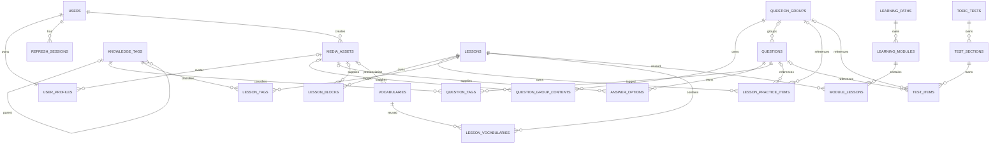

# TOEIC Core CRUD ERD v1

## Migration ownership

| Migration | Tables/change |
| --- | --- |
| V1 | Empty baseline |
| V2 | users, user_profiles, refresh_sessions |
| V3 | media_assets, knowledge_tags, add user profile avatar FK |
| V4 | question_groups, question_group_contents, questions, answer_options, question_tags |
| V5 | lessons, lesson_blocks, lesson_practice_items, lesson_tags, vocabularies, lesson_vocabularies |
| V6 | learning_paths, learning_modules, module_lessons |
| V7 | toeic_tests, test_sections, test_items |
| V8 | Only demonstrated hardening constraints/indexes; never reserved speculatively |

## Logical ERD



## Physical table dictionary

All timestamps are `timestamptz`, IDs are application-generated `uuid`, FK delete behavior is `RESTRICT` unless
the child is owned by its parent, in which case it is `CASCADE`. Enum-like `varchar` columns have database check
constraints matching the values below. Names in brackets are nullable.

```text
users
  id uuid PK
  email varchar(254) NOT NULL UQ                 -- canonical lowercase
  password_hash varchar(255) NOT NULL
  role varchar(20) NOT NULL CHECK ADMIN|USER
  status varchar(20) NOT NULL CHECK ACTIVE|DISABLED
  created_at, updated_at NOT NULL

user_profiles
  id uuid PK
  user_id uuid NOT NULL UQ FK users(id) CASCADE
  full_name varchar(120) NOT NULL
  [avatar_media_id uuid FK media_assets(id) RESTRICT] -- added by V3
  [target_score smallint CHECK 10..990]
  [current_level varchar(30) CHECK BEGINNER|INTERMEDIATE|ADVANCED]
  updated_at NOT NULL

refresh_sessions
  id uuid PK
  user_id uuid NOT NULL FK users(id) CASCADE
  family_id uuid NOT NULL
  token_hash char(64) NOT NULL UQ
  [replaced_by_id uuid FK refresh_sessions(id) RESTRICT]
  expires_at, created_at NOT NULL
  [rotated_at], [revoked_at]
  [user_agent varchar(512)]

media_assets
  id uuid PK
  original_filename varchar(255) NOT NULL
  display_name varchar(255) NOT NULL
  [description varchar(1000)]
  media_type varchar(20) NOT NULL CHECK AUDIO|IMAGE
  mime_type varchar(100) NOT NULL
  storage_provider varchar(20) NOT NULL CHECK R2
  bucket_name varchar(255) NOT NULL
  object_key varchar(1024) NOT NULL UQ
  file_size bigint NOT NULL CHECK > 0
  status varchar(30) NOT NULL CHECK ACTIVE|DELETE_PENDING|DELETE_FAILED|DELETED
  created_by uuid NOT NULL FK users(id) RESTRICT
  created_at, updated_at NOT NULL

knowledge_tags
  id uuid PK
  [parent_id uuid FK knowledge_tags(id) RESTRICT] CHECK parent_id <> id
  name varchar(120) NOT NULL
  slug varchar(140) NOT NULL UQ
  [description varchar(1000)]
  status varchar(20) NOT NULL CHECK ACTIVE|ARCHIVED
  created_at, updated_at NOT NULL

question_groups
  id uuid PK
  part varchar(20) NOT NULL CHECK PART_1..PART_7
  [variant varchar(50)]
  title varchar(255) NOT NULL
  [transcript text]
  status varchar(20) NOT NULL CHECK DRAFT|PUBLISHED|ARCHIVED
  created_by uuid NOT NULL FK users(id) RESTRICT
  created_at, updated_at NOT NULL

question_group_contents
  id uuid PK
  group_id uuid NOT NULL FK question_groups(id) CASCADE
  content_type varchar(20) NOT NULL CHECK TEXT|RICH_TEXT|IMAGE|AUDIO
  [text_content text], [content_json jsonb], [media_id uuid FK media_assets(id) RESTRICT]
  display_order integer NOT NULL CHECK > 0
  UQ(group_id, display_order)

questions
  id uuid PK
  [group_id uuid FK question_groups(id) CASCADE]
  part varchar(20) NOT NULL CHECK PART_1..PART_7
  question_text text NOT NULL
  [explanation text]
  difficulty varchar(20) NOT NULL CHECK EASY|MEDIUM|HARD
  status varchar(20) NOT NULL CHECK DRAFT|PUBLISHED|ARCHIVED
  created_by uuid NOT NULL FK users(id) RESTRICT
  created_at, updated_at NOT NULL

answer_options
  id uuid PK
  question_id uuid NOT NULL FK questions(id) CASCADE
  label varchar(10) NOT NULL
  [content text], [media_id uuid FK media_assets(id) RESTRICT]
  is_correct boolean NOT NULL
  display_order integer NOT NULL CHECK > 0
  CHECK content IS NOT NULL OR media_id IS NOT NULL
  UQ(question_id, label), UQ(question_id, display_order)

question_tags
  question_id uuid FK questions(id) CASCADE
  tag_id uuid FK knowledge_tags(id) RESTRICT
  PK(question_id, tag_id)

lessons
  id uuid PK
  title varchar(255) NOT NULL
  slug varchar(280) NOT NULL UQ
  lesson_type varchar(20) NOT NULL CHECK GRAMMAR|VOCABULARY|LISTENING|READING
  [description varchar(2000)]
  difficulty varchar(20) NOT NULL CHECK EASY|MEDIUM|HARD
  status varchar(20) NOT NULL CHECK DRAFT|PUBLISHED|ARCHIVED
  created_by uuid NOT NULL FK users(id) RESTRICT
  created_at, updated_at NOT NULL

lesson_blocks
  id uuid PK
  lesson_id uuid NOT NULL FK lessons(id) CASCADE
  block_type varchar(20) NOT NULL CHECK HEADING|RICH_TEXT|IMAGE|AUDIO
  [schema_version integer CHECK > 0]
  [content_json jsonb], [media_id uuid FK media_assets(id) RESTRICT]
  display_order integer NOT NULL CHECK > 0
  UQ(lesson_id, display_order)

lesson_practice_items
  id uuid PK
  lesson_id uuid NOT NULL FK lessons(id) CASCADE
  [question_id uuid FK questions(id) RESTRICT]
  [question_group_id uuid FK question_groups(id) RESTRICT]
  display_order integer NOT NULL CHECK > 0
  CHECK exactly one question reference is non-null
  UQ(lesson_id, display_order)

lesson_tags
  lesson_id uuid FK lessons(id) CASCADE
  tag_id uuid FK knowledge_tags(id) RESTRICT
  PK(lesson_id, tag_id)

vocabularies
  id uuid PK
  word varchar(255) NOT NULL
  [phonetic varchar(255)]
  part_of_speech varchar(30) NOT NULL
  meaning varchar(1000) NOT NULL
  [example varchar(2000)]
  [audio_media_id uuid FK media_assets(id) RESTRICT]
  status varchar(20) NOT NULL CHECK ACTIVE|ARCHIVED
  created_at, updated_at NOT NULL
  UQ index(lower(word), lower(meaning))

lesson_vocabularies
  lesson_id uuid FK lessons(id) CASCADE
  vocabulary_id uuid FK vocabularies(id) RESTRICT
  display_order integer NOT NULL CHECK > 0
  PK(lesson_id, vocabulary_id), UQ(lesson_id, display_order)

learning_paths
  id uuid PK
  title varchar(255) NOT NULL
  slug varchar(280) NOT NULL UQ
  [description varchar(2000)]
  target_score smallint NOT NULL CHECK 10..990
  starting_level varchar(30) NOT NULL CHECK BEGINNER|INTERMEDIATE|ADVANCED
  status varchar(20) NOT NULL CHECK DRAFT|PUBLISHED|ARCHIVED
  created_by uuid NOT NULL FK users(id) RESTRICT
  created_at, updated_at NOT NULL

learning_modules
  id uuid PK
  path_id uuid NOT NULL FK learning_paths(id) CASCADE
  title varchar(255) NOT NULL
  [description varchar(2000)]
  display_order integer NOT NULL CHECK > 0
  UQ(path_id, display_order)

module_lessons
  module_id uuid FK learning_modules(id) CASCADE
  lesson_id uuid FK lessons(id) RESTRICT
  display_order integer NOT NULL CHECK > 0
  PK(module_id, lesson_id), UQ(module_id, display_order)

toeic_tests
  id uuid PK
  title varchar(255) NOT NULL
  [description varchar(2000)]
  test_type varchar(30) NOT NULL CHECK PART_PRACTICE|MINI_TEST|FULL_TEST
  [blueprint_code varchar(50)]
  status varchar(20) NOT NULL CHECK DRAFT|PUBLISHED|ARCHIVED
  created_by uuid NOT NULL FK users(id) RESTRICT
  created_at, updated_at NOT NULL
  CHECK FULL_TEST iff blueprint_code is non-null

test_sections
  id uuid PK
  test_id uuid NOT NULL FK toeic_tests(id) CASCADE
  skill varchar(20) NOT NULL CHECK LISTENING|READING
  [part varchar(20) CHECK PART_1..PART_7]
  duration_seconds integer NOT NULL CHECK >= 0
  display_order integer NOT NULL CHECK > 0
  UQ(test_id, display_order)

test_items
  id uuid PK
  section_id uuid NOT NULL FK test_sections(id) CASCADE
  [question_id uuid FK questions(id) RESTRICT]
  [question_group_id uuid FK question_groups(id) RESTRICT]
  display_order integer NOT NULL CHECK > 0
  CHECK exactly one question reference is non-null
  UQ(section_id, display_order)
```

Payload-shape checks that depend on type (for example group content or lesson block payload) are enforced both by
database checks where expressible and by service validation. Cross-row rules such as exactly one correct option,
taxonomy cycle detection and published dependency status remain transactional service/publication rules.

## Required constraints

### Identity

- `users(email)` unique on canonical value.
- `users.role` check `ADMIN|USER`; `users.status` check `ACTIVE|DISABLED`.
- `user_profiles.user_id` unique FK.
- `target_score` nullable and constrained to `10..990`.
- `refresh_sessions.token_hash` unique; indexes on `user_id`, `family_id`, `expires_at`.

### Media and taxonomy

- `media_assets.object_key` unique; `file_size > 0`.
- All content media FKs use `RESTRICT`.
- `knowledge_tags.slug` unique; `parent_id != id`; service additionally prevents deep cycles.

### Ordered aggregate children

- Every `display_order > 0`.
- Unique `(parent_id, display_order)` for contents, options, blocks, links, modules, sections and items.
- Reorder API replaces the whole ordered list inside one transaction.

### XOR references

- `lesson_practice_items`: exactly one of `question_id`, `question_group_id` is non-null.
- `test_items`: exactly one of `question_id`, `question_group_id` is non-null.

### Slugs and labels

- `lessons.slug`, `learning_paths.slug`, `knowledge_tags.slug` unique.
- `answer_options(question_id, label)` unique.
- `question_tags(question_id, tag_id)`, `lesson_tags(lesson_id, tag_id)`, `module_lessons(module_id, lesson_id)` unique.

## Index policy

- Required non-unique indexes: every non-PK FK used in parent/detail/usage queries; `refresh_sessions(family_id)`,
  `refresh_sessions(expires_at)`, and collection status/type columns only when introduced with the corresponding
  accepted filter endpoint.
- Add indexes for accepted filter paths only after query plan or required collection endpoint justifies them.
- Do not add speculative full-text, GIN JSONB or composite indexes in initial migrations.
